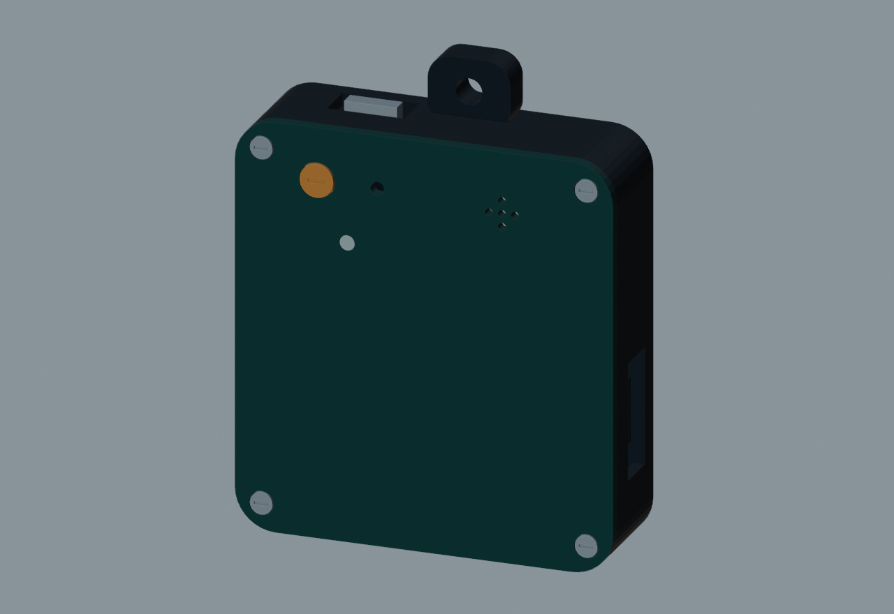
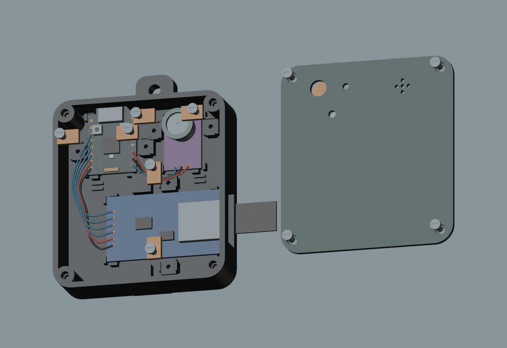

# Smart Recorder

**ESP32-C3 firmware and a printable enclosure for a portable WAV recorder.**

Press the board button to start or stop recording. Audio goes directly to a microSD card as 16 kHz, 16-bit mono WAV. The firmware starts a new file every five minutes and updates the current WAV header every ten seconds. The onboard LED shows recording and error states.

| Assembled enclosure render | Internal layout render |
| --- | --- |
|  |  |

## Build

Use an ESP32-C3 SuperMini, a 3.3 V SPI microSD module, a FAT32 card and one supported microphone.

| Microphone | Firmware configuration | Hardware notes |
| --- | --- | --- |
| INMP441 | `SMART_RECORDER_MAX4466=0` | I2S wiring below |
| GY-MAX4466 | `SMART_RECORDER_MAX4466=1` | [Wiring diagram](hardware/wiring-max4466.svg) and [V2 assembly instructions](hardware/print-v2/ASSEMBLY.md) |

For INMP441 connect BCLK to GPIO3, WS to GPIO4 and DOUT to GPIO5. Connect the SD module clock, MISO, MOSI and CS to GPIO6, GPIO7, GPIO10 and GPIO1 respectively. Use 3.3 V and a common ground. Connect the INMP441 L/R pin to ground.

1. Install the Espressif ESP32 board package (Arduino ESP32 3.3.x) in Arduino IDE.
2. Open the [firmware sketch](firmware/smart_recorder/smart_recorder.ino), select the microphone configuration and choose **ESP32C3 Dev Module** with **USB CDC On Boot** enabled.
3. Upload the sketch, insert the SD card and use BOOT after startup to toggle recording. Stop recording before removing the card. If the LED flashes, check the serial monitor at 115200 baud.

## Enclosure files

The V2 enclosure is sized for a GY-MAX4466 board and uses removable board clamps, a rear clip and a separate light pipe. The [Blender model](hardware/clip-v2.blend), [model generator](hardware/create_clip_v2.py) and [print files](hardware/print-v2/) are included. Measure your modules before printing.

**Prototype status** · Both firmware configurations were built in the original workspace. Recording quality, power behavior and fit on physical hardware still need validation.
